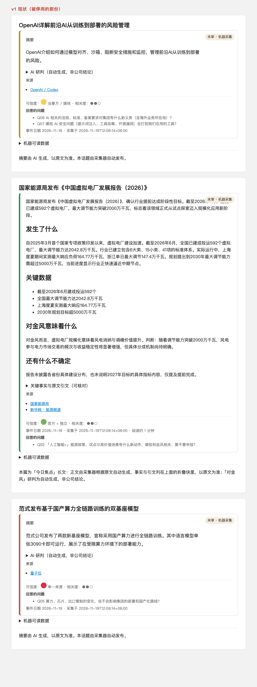
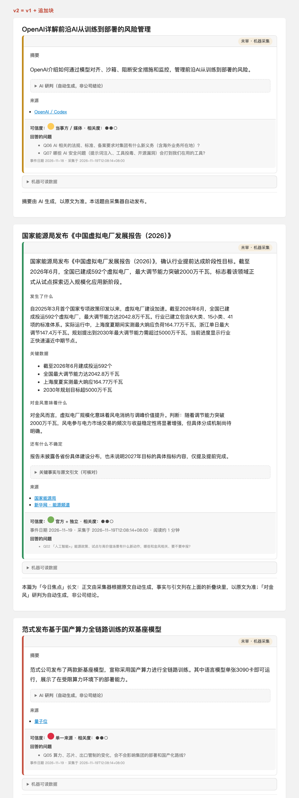

# 2026-11-19 话题帖样式对比：436 与 865，以及 v2

> 对比 http://10.12.3.232:8088/t/topic/436 （436）与 https://aicopilot.goldwind.com.cn:3211/t/openai-ai/865 （865），
> 判断哪个更好、给出更好的视觉方案。v2 已用线上真实帖子的 cooked HTML 做过 A/B 与编译校验。

## 1. 结论

**865 不是「排版差」，是「样式组件被停用了」。** 两篇正文的 markup 同源（都是 [wrap=ais-*] 分块），
观感差异 100% 来自主题组件 11「AI 情报站话题样式 v1」在正式社区 enabled=false：

    disabled_at   : 2026-11-17T06:39:21.373Z   （北京时间 11-17 14:39）
    disabled_by   : U8570（AI 运营团队）
    parent_themes : Foundation(-1)、Horizon(-2)   ← 组件仍挂在两个主题上，只是开关关着

436 所在的 10.12.3.232:8088 上同名组件（id=2，同一份 SCSS）仍然启用，所以同一份内容一边有卡片一边没有。

## 2. 逐项差异

| 位置 | 436（组件启用） | 865（组件停用） |
|---|---|---|
| 卡片容器 | 圆角 8px 白卡 + 1px 描边 | 无，纯段落 |
| 左侧 5px 色条 | 按 data-cred 取色：绿 #2f8f5b / 黄 #c18a1b / 红 #c4503f | 无 |
| 右上角状态胶囊 | 「未审 · 机器采集」/「已审」，由 data-review 生成 | 无 |
| 「摘要」标签 | 小号灰色 kicker | 与正文同级的加粗字 |
| 摘要正文 | 1.06em / 行高 1.8 | 默认 15px |
| 「对金风」 | 436 是常显的淡蓝色块（旧写法 ais-us） | 865 是折叠 details（11-19 新决定） |
| 来源 / 元信息 | 独立区块 + 虚线分隔，降为小号灰字 | 与正文同级，连成一片 |

## 3. 哪个更好

**视觉上 436 更好，但它的骨架比 865 旧。** 推荐形态是「436 的皮 + 865 的骨架」。

436 值得保留：① 左色条把可信度变成不用读字的信号；② 右上胶囊说清「这条没人看过」（分类 20 已对全员开放，这是合规要求）；
③ 摘要 / 来源 / 元信息分层，300 字能在 5 秒内被扫完。

436 该改：① 「对金风」常显把自动判断摆在事实前面——865 的折叠是对的；② 胶囊与正文抢位置；③ 元信息露出采集时间戳。

## 4. 真实渲染验证（这一步发现了线上 bug）

用三篇真实帖子的 cooked HTML 做 A/B：865（普通信号，yellow）、866（今日焦点长文，green）、870（普通信号，red）。
桌面 900px 与手机 430px 各一轮。

| v1 现状 | v2 |
|---|---|
|  |  |
| 手机 430：[v1](img/2026-11-19-v1-手机430.png) | 手机 430：[v2](img/2026-11-19-v2-手机430.png) |

v1 暴露的三个真问题（组件一旦重新启用就会全部出现）：

1. **胶囊压字**：v1 给 ais-summary 加 padding-right:7em 让位，但「今日焦点长文」没有 ais-summary 块（块首直接是导语 p），
   胶囊就叠在正文上——866 桌面端与手机端都能看到「确认行业提前…」被盖住。这是 11-19 焦点长文上线后引入的新情况，v1 没覆盖。
2. **长文标题过大**：## 发生了什么 等四节标题按站点默认 h2 渲染成 1.5em 粗体，比帖子标题还抢眼，焦点长文读起来像网页正文。
3. **元信息顺序乱、权重没降**：可信度/相关度/事件日期/回答的问题 全同级灰字堆在一起；事件日期夹在中间，采集时间戳直接露在正文里。

## 5. v2 改了什么

v2 = 你的 v1 原样保留 + 末尾追加一块（共 6 组规则），文件已生成：
**work/theme11/common/common.scss**（v1 4,577 字符 + v2 追加 2,951 字符，共 289 行）

| # | 改动 | 解决的 |
|---|---|---|
| 1 | 卡片顶部让出 2.9em 的「状态带」，胶囊放进带内（::after 画带，::before 是胶囊） | 胶囊永不再压字；v1 的 padding-right hack 全部删除 |
| 2 | 元信息变成卡片底部信息带（负边距吃掉内边距，贴住圆角） | 4 段灰字变成一条带；最后一行（事件日期/采集于）降为最小号最浅色 |
| 3 | 卡内折叠块（研判 / 关键事实与引文）收成虚线脚注 | 折叠条不再像裸三角 |
| 4 | 卡外折叠块（机器可读数据）改成实线圆角灰底 | 与卡片同一套语言 |
| 5 | 长文 h2 降为 13px kicker，正文 max-width 68ch，块首 p 放大到 1.12em | 焦点长文读起来是帖子而不是网页 |
| 6 | 来源列表与 meta 间距收紧、手机端 --ais-cap 归零 | 手机 430px 实测无重叠 |

**校验**：sass 1.77.8 编译通过（10,477 字节 CSS，无警告）；用编译产物重渲染三篇真实帖子，
与评审过的预览图 **逐字节一致**（sha256 相同），说明粘贴的就是看到的。

## 6. 落地路径

| 档 | 做法 | 谁来做 | 效果 |
|---|---|---|---|
| A | 后台 → 自定义 → 主题 → 组件 → AI 情报站话题样式 v1 → 启用 | 有后台权限的人点 1 次 | 回到 436 的样子，全站 ais-* 帖子统一（但会带出上面三个 v1 问题） |
| B | A + 把 work/theme11/common/common.scss 整份粘进组件、保存 | 同上 | 推荐形态 |
| C | 只改采集器 markup（不动 CSS） | 我，零权限 | 组件仍停用时也比现在好读 |

主题接口现状（2026-11-19 复测，与 11-16 的记录不同）：

| 请求 | 结果 | 说明 |
|---|---|---|
| PUT /admin/themes/11.json {} | 400 param is missing: theme | 路由存在，可改主题字段 |
| PUT /admin/customize/themes/11.json | 404 | 旧路径已不存在 |
| PATCH /admin/themes/11.json | 404 | 只接受 PUT |

## 7. 采集器侧还能顺手改两处（不涉及前端）

1. **焦点长文的 meta 顺序**：现在 render.topic_body_focus 把「事件日期/采集于/阅读约 N 分钟」放在「回答的问题」之前，
   于是底部信息带里时间戳夹在中间。应改成：可信度 → 回答的问题 → 事件日期。
2. **状态带左侧留白**：CSS 无法凭空造出左侧内容（没有多余元素），要显示「可信度 官方 + 独立」这类文字标签，
   需要采集器多输出一个 [wrap=ais-head cred=g] … [/wrap]。等 v2 稳定后再做，作为 v2.1。

## 8. 为什么会漏两天

组件 11-17 被关掉之后，每轮采集照常发帖、首页照常更新，只有帖子里的卡片静默消失，没有任何一层会报错。
补了 01-采集器/scripts/check_theme_style.py：把「组件开关 / 正文标记 / 页面是否真加载了这份 CSS」三者对一遍，不一致就非零退出。
当前跑出来：enabled=False、话题 870 带标记、页面未加载组件 CSS → exit 1。
